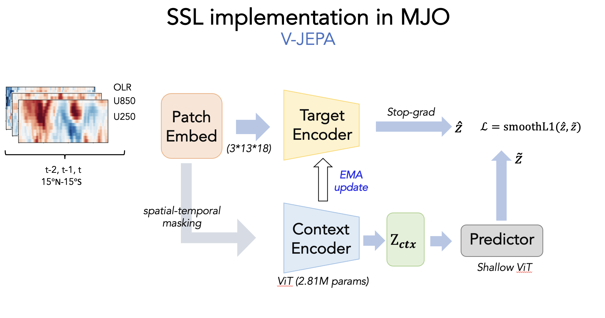
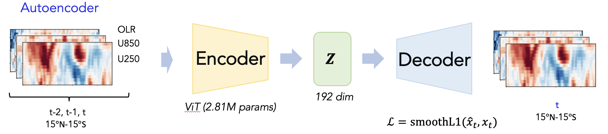

# jepa-coarse-graining
Coarse-graining turbulent dynamics in space and time with JEPA latents — compared against AE and time-lagged AE baselines on Surface QG.

This directory holds the **MJO case study**: a spatiotemporal **V-JEPA** and a matched
reconstruction **Autoencoder (AE)** trained on daily tropical OLR / U850 / U200 maps.
Both models use the **same ViT encoder, the same latent size (192), and byte-identical
input samples** — only the training objective differs, so the two latent spaces can be
compared directly.

---

## Data

| | |
|---|---|
| Variables | OLR (NOAA daily), U850, U200 (NCEP-2), channel order `olr, u850, u200` |
| Domain | 15°N–15°S (13 lat rows) × 0–357.5°E (144 lon, periodic), 2.5° grid |
| Anomalies | WH04 recipe: remove mean + 3 annual harmonics, then the trailing 120-day mean (no bandpass) |
| Normalization | per-variable global mean/std over the training years |
| Sample | 3 consecutive days `(t-2, t-1, t)` → `x ∈ R^(C=3, T=3, H=13, W=144)` |
| Split (by anchor day `t`) | train 1979–2014 (13,028 clips), val 2015–2020 (2,192 clips) |

Build the anomaly cache once (`data/anom_st/anom.npy`, `[N, 3, 13, 144]`):

```bash
python -m jepa.data.preprocess --config jepa/config_vjepa.yaml
```

---

## Shared encoder — `STViTBackbone` (`jepa/models/encoder.py`)

```
x (B, 3, 3, 13, 144)
 └ Conv3d patch embed, kernel = stride = (1 day, 1 lat, 8 lon = 20°)
   → 3 × 13 × 18 = 702 tokens, D = 192
 └ + fixed 3-D sin-cos positional embedding (periodic in longitude)
 └ 6 × Transformer block (4 heads, MLP ratio 4) + LayerNorm
tokens (B, 702, 192)
```

* 2.81M parameters (2.67M trainable + 0.13M fixed positional embedding).
* Each day keeps its own tokens (tubelet = 1), so the future day can be masked.
* Downstream feature: mean of the 234 day-`t` tokens → **one 192-d vector per day**.

---

## V-JEPA (`jepa/`)



From the visible (context) tokens of a 3-day clip, predict the **latent representations**
of the masked tokens. No pixel reconstruction.

* **Context encoder** — the ViT above, run only on the visible tokens → `z_ctx`.
* **Target encoder** — EMA copy of the context encoder (momentum 0.996 → 1.0, cosine),
  run on the full clip; the masked positions give the targets `ẑ` (stop-grad).
* **Predictor** — shallow ViT (4 blocks, width 96): `z_ctx` + positioned mask tokens → `z̃`.
* **Loss** — `L = smoothL1(z̃, ẑ)` in latent space.
* **Spatial–temporal masking** (`jepa/masks/masking.py`, `mode: mixed`), one of these per batch:
  * *spatial*: 2 longitude sectors, each 60–120° wide (wrapping across 0/360°), masked
    over all latitudes and all 3 days;
  * *temporal*: the whole day `t` is masked and predicted from days `t-2, t-1`.
* Trainable parameters: 3.16M (encoder 2.67M + predictor 0.48M).
* The downstream encoder is the **EMA target encoder**.

---

## Autoencoder (`AE/`)



A plain reconstruction baseline: **no masking, no EMA, no predictor**.

* **Encoder** — the same `STViTBackbone`, full clip → mean of day-`t` tokens → `z ∈ R^192`.
* **Decoder** — `SpatialDecoder` (`AE/models/decoder.py`): `z` is broadcast to 234
  query tokens + 2-D periodic positional embedding → 4 Transformer blocks (width 128) →
  linear head → un-patchify → `x̂_t ∈ R^(3, 13, 144)`.
* **Loss** — reconstruct day `t`: `L = MSE(x̂_t, x_t)` (`loss_type: mse`; `smooth_l1` is
  also supported).
* The 192-d bottleneck is the only thing preventing an identity map.
* Trainable parameters: 3.50M (encoder 2.67M + decoder 0.82M).

---

## V-JEPA vs AE at a glance

| | V-JEPA | AE |
|---|---|---|
| Encoder input | visible context tokens only | full 3-day clip |
| Target | latents of masked tokens (EMA encoder) | pixel field of day `t` |
| Loss space | latent (192-d per token) | physical field |
| Extra module | predictor (0.48M) | decoder (0.82M) |
| Anti-collapse | EMA target + narrow predictor | not needed (reconstruction) |
| Checkpoint for downstream | `last.tar` | `best.tar` |

**Why V-JEPA uses `last.tar`:** the latent val loss is not a model-selection signal. As the
EMA encoder improves, its targets get harder, so the val loss reaches its minimum early
(about epoch 3, undertrained) and rises afterwards. The AE's reconstruction val loss *is*
a valid selection criterion.

---

## Training

Both runs use identical settings: AdamW, lr 5e-4 → 1e-6 (cosine, 5 warm-up epochs),
weight decay 0.05, batch 512, 500 epochs, grad-clip 1.0, AMP, single A100.

```bash
conda activate /glade/work/weidong/.conda_envs/2DTurbEmulator

# CPU smoke tests (synthetic eastward-propagating packets)
python jepa/train_vjepa.py --config jepa/config_vjepa.yaml --smoke
python AE/train_ae.py      --config AE/config_ae.yaml      --smoke

# full runs (Derecho)
qsub jepa/submit_vjepa.pbs        # -> runs/vjepa/{last,best}.tar
qsub AE/submit_ae.pbs             # -> runs/ae/{last,best}.tar
```

Each checkpoint stores the full model plus `probe_encoder` (the bare encoder used downstream).

---

## Results: 8-phase RMM probe on active MJO days (`runs/compare/summary_metrics.csv`)

| | linear acc | macro-F1 | kNN acc | NMI | ARI | silhouette | bin acc |
|---|---|---|---|---|---|---|---|
| V-JEPA | 0.797 | 0.797 | 0.635 | 0.346 | 0.200 | **0.079** | **0.809** |
| AE | **0.938** | **0.937** | 0.609 | **0.431** | **0.267** | 0.034 | 0.668 |
| Forecast | 0.888 | 0.887 | **0.641** | 0.331 | 0.193 | 0.038 | 0.724 |

(Forecast is a third baseline: the same encoder and decoder trained to predict day `t+1`; see `FORECAST/`.)

---

## Layout

```
jepa/
  config_vjepa.yaml        data / encoder / mask / method / train
  train_vjepa.py           training loop
  models/encoder.py        STViTBackbone (shared encoder)
  models/predictor.py      shallow-ViT predictor
  models/vjepa.py          context + EMA target + predictor + latent loss
  models/pos_embed.py      3-D sin-cos embedding, periodic longitude
  masks/masking.py         spatial-sector / future-day masks
  data/                    anomaly preprocessing + 3-day clip dataset
  downstream/              embedding extraction, phase clustering, propagation
AE/
  config_ae.yaml           data/encoder blocks copied verbatim from the V-JEPA config
  train_ae.py              training loop (mirrors train_vjepa.py)
  models/ae.py             MJOAutoencoder
  models/decoder.py        SpatialDecoder (latent -> day-t field)
  downstream/              extraction, phases, monitoring index, AE-vs-JEPA comparison
```
